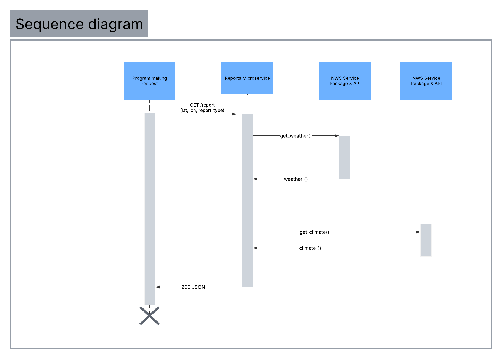

# Weather and Climate Reports

A weather and climate report fetching microservice built with Flask.

Give it a latitude and longitude, and it returns a JSON report built from:

- **NWS** (National Weather Service): weather forecast
- **NCDC** (NOAA Climate Data Online): historical climate data

## File structure

```
app.py              Flask app: reads the request, returns JSON
report.py           get_report(): decides which data goes in the report
services/
    nws.py          get_weather(): talks to the NWS API
    ncdc.py         get_climate(): talks to the NCDC API
requirements.txt    Python packages needed
```

A request moves through the files like this:

```
HTTP request -> app.py -> report.py -> services/nws.py and/or services/ncdc.py
```

## Setup

```
pip install -r requirements.txt
python app.py
```

Climate data needs a free NCDC token (request one at
https://www.ncdc.noaa.gov/cdo-web/token). Set it before starting the app:

```
$env:NCDC_TOKEN = "your-token"     # PowerShell
export NCDC_TOKEN=your-token       # bash
```

Weather data works without a token. NWS only covers the United States and its territories.

## Usage

```
GET /report?lat=<latitude>&lon=<longitude>&type=<all|weather|climate>
```

`type` is optional and defaults to `all`.

Example:

```
http://127.0.0.1:5000/report?lat=44.56&lon=-123.26&type=weather
```

Example response (`type=all`, trimmed to one forecast period and one month):

```json
{
  "location": {"lat": 44.56, "lon": -123.26},
  "report_type": "all",
  "weather": {
    "source": "NWS",
    "location": {"lat": 44.56, "lon": -123.26},
    "place": {"city": "Corvallis", "state": "OR"},
    "updated": "2026-11-16T23:41:19+00:00",
    "forecast": [
      {
        "name": "This Afternoon",
        "start": "2026-11-16T15:00:00-08:00",
        "end": "2026-11-16T18:00:00-08:00",
        "is_daytime": true,
        "temperature": 53,
        "temperature_unit": "F",
        "precip_chance_percent": 58,
        "wind": "2 mph SSW",
        "summary": "Rain Showers Likely",
        "details": "Rain showers likely. Partly sunny. High near 53, ..."
      }
    ]
  },
  "climate": {
    "source": "NCDC",
    "location": {"lat": 44.56, "lon": -123.26},
    "station": {
      "id": "GHCND:USC00351862",
      "name": "CORVALLIS STATE UNIVERSITY, OR US",
      "lat": 44.6, "lon": -123.2,
      "elevation_m": 70,
      "distance_km": 6.5
    },
    "period": {"start": "2025-10", "end": "2026-09"},
    "units": {"temperature": "F", "precipitation": "in"},
    "summary": {
      "avg_temp": 53.1,
      "avg_high": 64.2,
      "avg_low": 42.0,
      "total_precip": 41.37,
      "months_with_data": 12
    },
    "monthly": [
      {"month": "2025-10", "avg_temp": 54.3, "avg_high": 65.1, "avg_low": 43.5, "precip": 3.12}
    ]
  }
}
```

The climate section covers the 12 most recent months that the nearest active
weather station has reported. Any value NCDC doesn't have is `null`.

## Test

```
.venv\Scripts\Activate.ps1
python -m unittest -v
```

